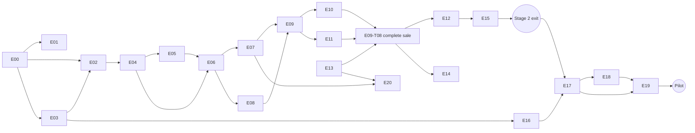

# 01 — Epics and PRD Traceability

## 1. Epics

| Epic | Name | Stages | Outcome | Tasks |
|---|---|---|---|---|
| E00 | Engineering foundation | 0 | Monorepo, CI on Windows and Linux, ADRs, contracts folder, seed tooling, Stage 0 vertical slice | T01–T06 |
| E01 | Desktop shell and IPC | 0 | Tauri 2 packaging, typed IPC, locked-down capabilities, logging with redaction | T01–T04 |
| E02 | Local persistence | 0 | SQLite durability settings, migrations with backup, single atomic write path, crash harness | T01–T04 |
| E03 | Domain primitives | 0 | Money, Quantity, Rate, IDs, Clock, rounding and allocation, error catalogue | T01–T04 |
| E04 | Business setup and configuration | 1 | Offline-capable workspace creation, first-run wizard, sandbox/live mode, typed settings | T01–T03 |
| E05 | Staff identity and access | 1 | Roles, PIN auth with lockout, permission enforcement in the application layer, approvals, inactivity lock | T01–T06 |
| E06 | Catalogue | 1 | Products, variants, barcodes, categories, taxes, fast search, CSV import | T01–T08 |
| E07 | Barcode input | 0–1 | Keyboard-wedge capture, scan pipeline with correct dedupe, virtual scanner, unknown-code flow | T01–T04 |
| E08 | Pricing, tax and discounts | 1 | A deterministic pricing engine, golden scenarios, discount permissions | T01–T03 |
| E09 | Cart and checkout | 1–2 | Cart aggregate, recovery, keyboard-first checkout UI, **atomic sale completion** | T01–T08 |
| E10 | Payments and tenders | 2 | Cash, split and external tenders with honest status; mock payment provider | T01–T03 |
| E11 | Inventory ledger | 2 | Append-only movements, balance projection, receiving, adjustments, negative-stock policy, low stock | T01–T06 |
| E12 | Returns and refunds | 2 | Linked returns, quantity limits, exact proportional refunds, dispositions, sales history UI | T01–T04 |
| E13 | Receipts and printing | 0, 2 | Canonical receipt document, HTML/PDF/ESC-POS renderers, print queue with safe uncertain outcomes | T01–T07 |
| E14 | Reports and exports | 2–3 | Defined measures, device and cloud scopes with staleness labels, CSV | T01–T05 |
| E15 | Audit, cash sessions and end of day | 2 | Audit catalogue and viewer, cash sessions, reconciled operating day | T01–T03 |
| E16 | Cloud platform and tenancy | 0, 3 | Axum API, Postgres with RLS, owner auth, device credentials, deploy, observability, backups | T01–T09 |
| E17 | Sync engine | 3 | Event contracts, push worker, idempotent ingestion, master-data versioning, pull, linking, fault suite | T01–T10 |
| E18 | Conflict resolution | 3 | Field-level conflict review and audited resolution | T01–T02 |
| E19 | Pilot hardening | 4 | Performance, crash and power-loss resilience, backup and restore, security, signing and updates, diagnostics, usability, acceptance suite | T01–T12 |
| E20 | Hardware validation | 5 | Compatibility registry, HID scanner, OS and ESC/POS printers, drawer, conditional scale and payments | T01–T07 |

### Epic dependency graph

## 2. Requirement → task traceability (all P0)

A requirement is **covered** when every task listed for it is done and its acceptance criteria
pass. `xtask trace` (added in E00-T05) reads the `**PRD**` fields of the task files and fails
CI if any P0 ID below has no task.

### Business setup and configuration

| Req | Tasks |
|---|---|
| SET-001 | E04-T01, E04-T02, E04-T03 |
| SET-002 | E04-T01, E04-T02 |
| SET-003 | E13-T02, E13-T07 |
| SET-004 | E04-T03, E06-T05, E08-T01 |
| SET-005 | E04-T03, E06-T02 |

### Catalogue

| Req | Tasks |
|---|---|
| CAT-001 | E06-T02, E06-T06a, E06-T06b |
| CAT-002 | E06-T01, E06-T02 |
| CAT-003 | E06-T03 |
| CAT-004 | E06-T01, E06-T03, E17-T06 (cross-register) |
| CAT-005 | E06-T02, E06-T06b |
| CAT-006 | E06-T02, E11-T01 |
| CAT-007 | E03-T02, E06-T02, E08-T01 |
| CAT-008 | E06-T07, E06-T08 |

### Barcode

| Req | Tasks |
|---|---|
| BAR-001 | E07-T02 |
| BAR-002 | E07-T01 |
| BAR-003 | E07-T03 |
| BAR-004 | E06-T03, E06-T04, E07-T02 |
| BAR-005 | E07-T02, E09-T01 |
| BAR-006 | E07-T04 |
| BAR-007 | E07-T01, E07-T02 |

### Checkout

| Req | Tasks |
|---|---|
| POS-001 | E09-T01 |
| POS-002 | E07-T02, E09-T04 |
| POS-003 | E09-T01, E09-T03 |
| POS-004 | E08-T02 |
| POS-005 | E03-T03, E08-T01, E08-T03 |
| POS-006 | E10-T01, E10-T03 |
| POS-007 | E10-T01, E10-T03 |
| POS-008 | E09-T08 |
| POS-009 | E09-T08 |
| POS-010 | E09-T08, E13-T02 |
| POS-011 | E09-T02 |

### Payments

| Req | Tasks |
|---|---|
| PAY-001 | E09-T08, E10-T01 |
| PAY-002 | E10-T01 |
| PAY-003 | E10-T01, E10-T03 |
| PAY-004 | E10-T01, E10-T02 |
| PAY-005 | E10-T01, E19-T05 |
| PAY-006 | E10-T02 |

### Inventory

| Req | Tasks |
|---|---|
| INV-001 | E11-T01 |
| INV-002 | E11-T01, E11-T02, E11-T03 |
| INV-003 | E11-T01 |
| INV-004 | E11-T01, E11-T06 |
| INV-005 | E11-T02 |
| INV-006 | E11-T03 |
| INV-007 | E11-T05 |
| INV-008 | E11-T04, E17-T05 |
| INV-009 | E12-T02 |

### Returns

| Req | Tasks |
|---|---|
| RET-001 | E12-T04 |
| RET-002 | E09-T08, E12-T02, E12-T04 |
| RET-003 | E12-T01 |
| RET-004 | E12-T01, E12-T02 |
| RET-005 | E12-T02 |
| RET-006 | E12-T02 |
| RET-007 | E12-T02 |

### Receipts

| Req | Tasks |
|---|---|
| RCP-001 | E13-T02 |
| RCP-002 | E13-T03 |
| RCP-003 | E13-T04 |
| RCP-004 | E13-T03, E13-T05 |
| RCP-005 | E13-T01, E13-T05 |
| RCP-006 | E13-T06 |
| RCP-007 | E13-T06 |

### Staff and access

| Req | Tasks |
|---|---|
| IAM-001 | E05-T01, E05-T03 |
| IAM-002 | E05-T01 |
| IAM-003 | E05-T03 |
| IAM-004 | E09-T08, E11-T03, E12-T02, E15-T01 |
| IAM-005 | E05-T05 |

### Reports

| Req | Tasks |
|---|---|
| REP-001 | E14-T01 |
| REP-002 | E14-T01 |
| REP-003 | E14-T01 |
| REP-004 | E14-T02 |
| REP-005 | E11-T05, E14-T02 |
| REP-006 | E14-T04 |

### Sync

| Req | Tasks |
|---|---|
| SYN-001 | E16-T04, E17-T08 |
| SYN-002 | E17-T07 |
| SYN-003 | E02-T03, E17-T02 |
| SYN-004 | E17-T03 |
| SYN-005 | E17-T01, E17-T04 |
| SYN-006 | E17-T03, E17-T04 |
| SYN-007 | E17-T09 |
| SYN-008 | E17-T07 |
| SYN-009 | E11-T01, E17-T05 |
| SYN-010 | E17-T06, E18-T01, E18-T02 |

### Non-functional targets (PRD §14)

| Target | Tasks |
|---|---|
| NFR-lookup (< 50 ms) | E06-T04, E19-T01 |
| NFR-add-to-cart (< 100 ms) | E07-T02, E09-T07, E19-T01 |
| NFR-search (< 150 ms) | E06-T04, E19-T01 |
| NFR-commit (< 500 ms) | E02-T03, E09-T08, E19-T01 |
| NFR-launch (< 5 s) | E01-T01, E19-T01 |
| NFR-offline (7 days) | E17-T08 (7-day backlog), E19-T09 |
| NFR-sync-correctness | E17-T04, E17-T10 |
| NFR-crash-recovery | E02-T04, E19-T02 |
| NFR-catalogue-scale | E00-T04, E06-T04 |
| NFR-sales-history (500k lines) | E14-T01, E12-T03, E19-T01 |
| NFR-accessibility | E09-T05, E19-T08 |
| NFR-reliability | E13-T06, E17-T03, E17-T10 |
| NFR-observability | E01-T04, E16-T08, E19-T07 |

### Security (PRD §13)

| Requirement | Tasks |
|---|---|
| TLS, device credentials | E16-T04, E16-T07 |
| OS credential store | E16-T04 |
| Least-privilege Tauri | E01-T03 |
| PIN hashing and lockout | E05-T02 |
| Sensitive-action approval | E05-T04, E08-T02, E11-T03, E12-T02 |
| No card data | E10-T01, E19-T05 |
| Log redaction | E01-T04, E16-T08 |
| Backups | E16-T07, E16-T09, E19-T03 |
| Signed updates | E19-T06 |
| Data export | E14-T04, E19-T04 |
| Retention | E19-T10 |
| Legal/PCI review | E19-T05, E19-T10 |

P1 and P2 requirements are listed in [tasks/post-mvp.md](tasks/post-mvp.md). Two of them are
pulled forward because they cost little:

- **CAT-009** (catalogue CSV export) in E14-T04
- a minimal **REP-008** in E14-T05

## 3. Derived requirements

Product owner: please veto or confirm each of these. They are things the PRD implies, or that
the engineering design needs, without an explicit FR ID.

| ID | Derived requirement | Why | Task |
|---|---|---|---|
| DER-001 | Cash sessions: open float, blind count, close with variance, Z summary | The Stage 2 exit gate needs a "reconciled" day. `cash_sessions` appears in PRD §9.2 but not in any FR. | E15-T02 (D-11) |
| DER-002 | Sandbox/live mode; sandbox sales excluded from reports | PRD §7.1 steps 8–9 | E04-T02, E14-T01 |
| DER-003 | Receipts carry a Code128 of the receipt number, used for scan-to-return | Makes RET-003 lookup fast | E13-T02, E12-T03 |
| DER-004 | Reject external references that look like card numbers (Luhn-valid runs of 13–19 digits) | Defends PAY-005 against operators typing a PAN into the reference field | E10-T01 |
| DER-005 | Cashier discount limit with manager approval above it | Turns "configured permissions" (POS-004) and "discount above threshold" (§13) into something concrete | E08-T02 |
| DER-006 | Inactivity lock keeps the cart and allows a switch of user | IAM-005 implies the lock must not destroy work | E05-T05 |
| DER-007 | Device clock-skew warning | Supports PRD §16.3 clock drift tests | E17-T03 |
| DER-008 | Scanner keyboard-layout mismatch hint | A common wedge-scanner failure in non-US layouts | E20-T02 |
| DER-009 | Join an existing cloud business only from an empty local database | Avoids an MVP merge of two populated workspaces (D-10) | E17-T08 |
| DER-010 | Post-restore sync re-base | Without it, restoring a backup could reuse `local_sequence` or `event_id` values, or lose synced sales | E19-T03 |
